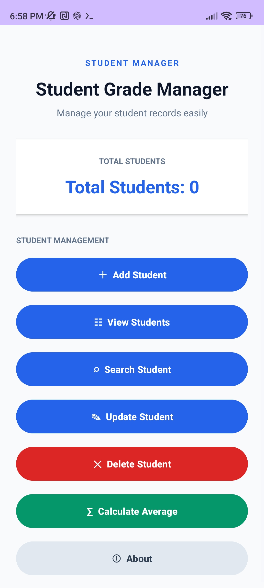

# Student Grade Manager

A simple Android application for managing student grades and tracking academic performance.

## Features
- Add and manage student grades
- Calculate academic results
- Simple and user-friendly interface
- Android Release APK

## Tech Stack
- Java
- Android SDK
- Gradle

## Developer
**Zeyad Mohamed Refaat**

Software Engineering Student  
Suez Canal University

## Repository
This project was developed as part of my journey in Android development and software engineering.

## Screenshot

